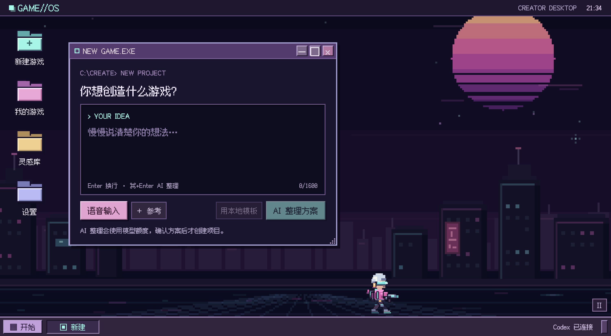
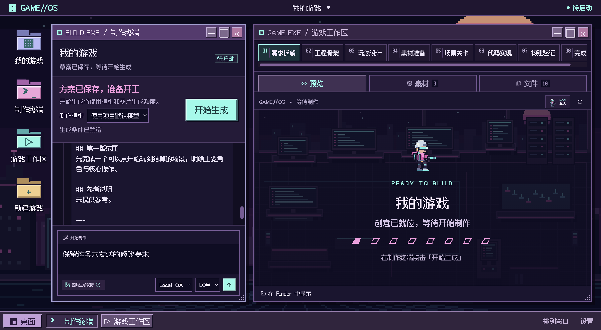

# GU.AI · GAME//OS

A cyberpunk pixel desktop for creating games with an AI agent.

[中文说明](README.zh-CN.md) · [Creation workflow](docs/LOCAL_CREATION_FLOW.md) · [Architecture](docs/ARCHITECTURE.md)



Describe your idea, review an editable game brief, and explicitly start production. GU.AI brings project folders, a creation terminal, game previews and an animated pixel companion into one desktop workspace.

**Status:** local Electron developer preview, primarily checked on macOS. This repository is a public fork of [Innate-Labs/Noobi.ai](https://github.com/Innate-Labs/Noobi.ai). The upstream repository has no published license; this fork does **not** add an open-source license or grant redistribution rights to upstream code. See [provenance and licensing](NOTICE.md).

## What is implemented

- Pixel desktop with draggable, resizable and minimizable windows, project folders and a cyberpunk companion.
- Idea → AI-assisted brief → editable confirmation → local project. A local-template path is available without a model call.
- Separate production terminal and preview/assets/files workspace; explicit command approvals and structured progress.
- Local project persistence and reopening, Codex connection/settings, and Web/Godot production infrastructure inherited from the upstream project.
- Voice input with record, stop, explicit upload, transcript review and append. API credentials are kept in encrypted local settings; real ASR service acceptance is still pending.
- Consistent dark-purple, cyan and pink pixel styling across creation, production, settings and approval dialogs.



Screenshots use isolated demonstration data. The waiting scene is part of the platform UI, not a generated game or a promise of generation quality.

## Run locally

Requires Node.js 22+, npm 10+ and a desktop session. Real AI work also requires your own compatible Codex account and any relevant media service access.

```bash
git clone https://github.com/buu206/GU.AI.git
cd GU.AI
npm ci
npm run dev
```

1. Open settings and connect Codex with your own account.
2. Enter an idea. Enter inserts a newline; Cmd/Ctrl+Enter requests AI brief planning. Review and edit the result, or choose the local template.
3. Confirm the brief and select an empty local folder. Saving a draft does not start game generation.
4. Check production prerequisites, then explicitly click **开始生成** to start agent work. Model and media calls use your own quota.

For optional speech input, configure **设置 → 语音识别**, or copy `.env.example` to `.env.local` for development and fill in your own service credentials. Never commit that file. Saving credentials alone does not verify service availability; provider/model compatibility and real transcription quality need your own validation.

## Validation and packaging

```bash
npm run typecheck
npm test
npm run build
# Optional macOS development package, not a signed public release:
npm run package:mac
```

Unit tests and builds do not require generating a game. The `smoke:codex`, `smoke:image` and other live-service scripts may use credentials and consume quota; inspect each script before running it.

## Scope and limitations

This is a local desktop application, not a hosted multi-user website. There is no public generation backend, cloud account/billing service, project sync, or one-click public game hosting. No signed installer or cross-platform release is provided. Actual game quality and supported media capabilities depend on the configured runtime and providers. Windows/Linux packaging and real speech recognition still need validation.

## Project layout

| Directory | Responsibility |
| --- | --- |
| `src/main/` | Electron host, Codex runtime, projects, approvals and speech services |
| `src/renderer/desktop/` | Pixel desktop, windows, companion and production workspace |
| `src/renderer/components/` | Settings, approvals, composer and inspectors |
| `src/shared/` | IPC contracts and creation/speech validation |
| `docs/` | Architecture and workflow details |

## Credits and license status

GU.AI customizes the desktop interaction, creation flow, voice input and visual identity of **Noobi.ai**. The original game-agent infrastructure and existing assets remain credited to **Innate-Labs and the original contributors**. This repository preserves its upstream fork relationship and history.

Public visibility is not an open-source license. Upstream permission or a compatible upstream license is required before declaring the complete derivative available under MIT, Apache-2.0 or another open-source license. Third-party dependencies, fonts and assets retain their respective terms. See [NOTICE.md](NOTICE.md).
