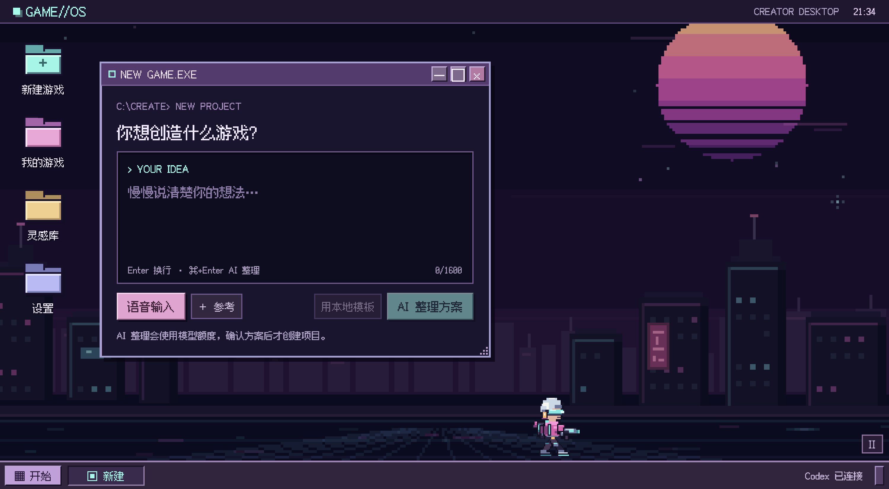
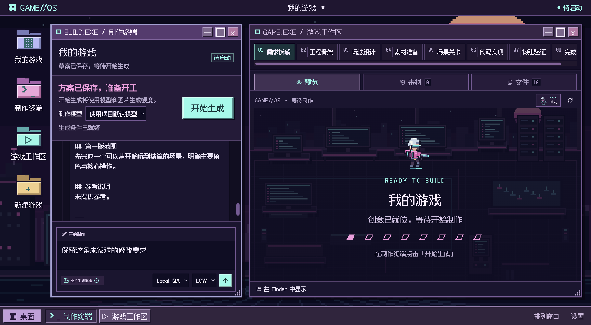

# GU.AI · GAME//OS

把游戏想法放进一台赛博朋克像素电脑。

[English](README.md) · [创作与语音流程](docs/LOCAL_CREATION_FLOW.md) · [架构说明](docs/ARCHITECTURE.md)



输入游戏想法，先让 AI 整理可编辑的方案，再由你确认创建项目、开始制作。桌面文件夹、制作终端、游戏预览和像素桌宠放在同一个工作区里。

**当前是本地 Electron 开发预览版，主要在 macOS 验证。** 不是已经上线的多人网站，也没有公共游戏生成后端。

**来源与许可：** 本项目是 [Innate-Labs/Noobi.ai](https://github.com/Innate-Labs/Noobi.ai) 的公开 Fork。上游尚未提供开源许可证，因此这里没有擅自给整套代码加上 MIT 等许可。公开可查看与可自由再分发是两回事，完整说明见 [NOTICE.md](NOTICE.md)。

## 现在可以做什么

- **像素电脑桌面：** 文件夹入口，可拖动、缩放、最小化的窗口，以及会走动和响应点击的赛博桌宠。
- **先确认，再制作：** 想法 → AI 整理方案 → 人工修改确认 → 创建本地项目 → 明确启动生成。也可直接使用本地模板。
- **制作工作台：** 左侧制作终端，右侧游戏预览、素材与文件；保留任务状态、命令审批及用户补充需求。
- **本地项目管理：** 保存、重新打开项目；沿用上游 Codex 和 Web/Godot 制作基础设施。
- **语音输入：** 录音结束后手动上传识别，校对文字后追加到想法。密钥保存在系统加密保护的本地设置中，真实语音服务仍待验收。
- **统一设计：** 创作页、制作页、设置和审批弹窗使用深紫、青色、粉色的像素风。



截图使用隔离示例数据；等待制作画面属于平台界面，不是生成完成的游戏。

## 本机运行

准备 Node.js 22+、npm 10+ 和桌面环境。真实 AI 工作需要你自己的 Codex 账户和相应素材服务访问权限。

```bash
git clone https://github.com/buu206/GU.AI.git
cd GU.AI
npm ci
npm run dev
```

1. 在设置中连接自己的 Codex 账户。
2. 输入游戏想法。**Enter 换行，Cmd/Ctrl+Enter 整理方案**；也可以点「用本地模板」。
3. 修改并确认方案，选择一个空的本地文件夹。保存草案不会开始生成游戏。
4. 制作条件检查通过后，明确点击「开始生成」。这一步会使用模型和素材服务额度。

语音为可选配置：通过「设置 → 语音识别」填写自己的服务；开发时也可以复制 `.env.example` 为 `.env.local`。真实 Key 不应写进源码或提交到 Git。保存配置不等于服务已连通，识别效果、接口兼容性与额度需独立验证。

## 检查与打包

```bash
npm run typecheck
npm test
npm run build
# 可选：制作 macOS 开发安装包，未提供正式签名版
npm run package:mac
```

构建和单元测试不需要生成游戏。`smoke:codex`、`smoke:image` 等真实服务脚本可能消耗额度，使用前先查看对应脚本。

## 当前边界

项目保存在本机；尚无云同步、用户计费、公共后端或一键公开发布游戏。未发布正式签名安装包，Windows/Linux 打包与真实语音识别仍待验证。游戏效果和素材能力取决于用户配置的运行时及服务。

## 代码入口

| 目录 | 内容 |
| --- | --- |
| `src/main/` | Electron 主进程、Codex、项目、审批与语音服务 |
| `src/renderer/desktop/` | 像素桌面、窗口、桌宠与制作工作台 |
| `src/renderer/components/` | 设置、审批、输入和预览组件 |
| `src/shared/` | IPC 契约、创作方案与语音验证 |
| `docs/` | 工作流与架构说明 |

## 致谢与许可状态

GU.AI 基于 Noobi.ai 定制桌面交互、创作流程、语音输入与视觉风格。原始游戏 Agent 基础设施及既有素材归属于 **Innate-Labs 与原贡献者**，Fork 关系和原始历史予以保留。

完整衍生项目取得兼容的上游许可或明确授权后，才能正式选定开源许可证。目前不要把此仓库描述为 MIT/Apache 授权项目。依赖、字体及素材继续适用各自条款，详见 [NOTICE.md](NOTICE.md)。
